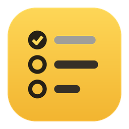

<p align="center"></p>

# Rabisco

Lista de tarefas + kanban de canto de tela para Windows 11, em Python com **PySide6** (e nada além da biblioteca padrão).

Abre docado na lateral da tela, você escreve, dá Enter e fecha. Quando quiser mais, cada tarefa pode ter descrição, prazo e grupo — mas nada disso é obrigatório.

## Rodando

```bash
pip install -r requirements.txt
```

Depois é só dar duplo clique em `rabisco.pyw` (ou `pythonw rabisco.pyw`; `python -m rabisco` também funciona).

O app fica no tray. Para abrir junto com o Windows: menu **⋯ → Iniciar com o Windows**.

## Uso

| Ação | Como |
| --- | --- |
| Mostrar / esconder de qualquer lugar | `Ctrl+Alt+K` (ou clique no ícone do tray) |
| Ver todos os atalhos | `F1` (ou menu **⋯ → Atalhos de teclado**) |
| Adicionar | digitar + `Enter` |
| Adicionar já em "Fazendo" | `Shift+Enter` |
| Adicionar e abrir detalhes | `Ctrl+Enter` ou o ícone de lápis no campo |
| Ir do campo para a lista / voltar | `↓` / `↑` na primeira tarefa (ou `Ctrl+N`) |
| Começar uma tarefa com a lista em foco | é só digitar: o texto vai para o campo |
| Fechar | `Esc` |
| Lista / Quadro | `Ctrl+1` / `Ctrl+2` (`Ctrl+Tab` alterna) |
| Filtrar por grupo | `Alt+1`…`Alt+9` (`Alt+0` = tudo) |
| Ocultar / mostrar feitas | `Ctrl+H` |
| Relatório do que foi concluído | `Ctrl+R` (ou menu **⋯ → Relatório de concluídas**) |
| Concluir / reabrir | clique no círculo ou `Espaço` (a seleção fica no lugar, pronta pra próxima) |
| Concluir com comentário | `Shift+Espaço` ou Shift+clique no círculo |
| Buscar | `Ctrl+F` (`Enter`/`↓` vai pros resultados, `Esc` fecha) |
| Adiar o prazo 1 dia / trazer 1 dia | `Ctrl+→` / `Ctrl+←` (mais opções no botão direito → *Prazo*) |
| Marcar / desmarcar "pra já" | `!` na tarefa selecionada (ou botão direito) |
| Marcar / desmarcar delegada | `>` na tarefa selecionada (ou botão direito → *Delegar para…*) |
| Detalhes (descrição, prazo, grupo) | duplo clique ou `Enter` na tarefa; `Ctrl+Enter` ou `Esc` volta |
| Renomear rápido | `F2` |
| Subir / descer na lista | `Alt+↑` / `Alt+↓` (ou arrastar) |
| Mudar status (A fazer ↔ Fazendo ↔ Feito) | `Alt+←` / `Alt+→` |
| Trocar de coluna no quadro | `←` / `→` |
| Excluir | `Del` |
| Desfazer exclusão ou conclusão | `Ctrl+Z` (ou o botão no rodapé) |
| Mover entre colunas ou reordenar | arrastar e soltar |

### Pra já ⚡

Para aquelas tarefas rápidas que você quer tirar da cabeça logo ("analisar o email que o Fulano vai mandar", "investigar o erro X"), comece com `!`:

```
!analisar email do Fulano
!investigar erro no deploy #trabalho
```

Elas ficam sempre no topo (na lista e no quadro), ganham uma faixa amarela e, em vez de prazo, mostram **há quanto tempo estão esperando**: "há 40 min" → amarelo depois de 4h → vermelho depois de 1 dia (se está parada há um dia, não era tão rápida assim). O rodapé mostra quantas "pra já" estão abertas.

### Delegadas ↗

Para o que você passou pra alguém e só precisa acompanhar. Dizer pra quem é opcional:

```
>Ana revisar o contrato
revisar PR do backend >
> levantar números do Q3
```

- `>Nome` em qualquer lugar: delegada pra Nome
- `>` sozinho no começo ou no fim: delegada sem dizer pra quem

Delegadas vão para a seção **Delegadas** (abaixo de "Sem prazo", já que não estão no seu prato), ficam no fim das colunas do quadro e mostram **"Ana · há 2d"**: amarelo depois de 3 dias (hora de cobrar), vermelho depois de 1 semana. Não contam como pendentes no rodapé, que mostra quantas estão delegadas à parte. Nos detalhes há o checkbox *Delegada* e um campo "pra quem" que autocompleta com as pessoas já usadas. Pra já e delegada são excludentes: marcar uma desmarca a outra.

### Lista agrupada

A lista se organiza sozinha em seções, cada uma recolhível com um clique no cabeçalho:

| Seção | O que entra | Ordem |
| --- | --- | --- |
| ⚡ Pra já | marcadas com `!` | manual |
| ▶ Fazendo | em andamento | manual |
| ⏰ Hoje e atrasadas | prazo hoje ou vencido | por prazo |
| 📅 Próximos dias | prazo futuro | por prazo |
| • Sem prazo | o resto | manual (arrastando) |
| ↗ Delegadas | marcadas como delegadas | manual |
| ✓ Feitas | concluídas (recolhida por padrão) | — |

Seções vazias não aparecem. Arrastar uma tarefa para outra seção ajusta o que define a seção (ex.: soltar em "Pra já" marca como pra já; em "Fazendo" muda o status). Para voltar à lista plana: menu **⋯ → Agrupar lista em seções**.

### Digitação rápida

Dá para definir pra já, grupo e prazo direto no campo:

```
pagar boleto @10/12
ligar pro banco #casa @amanhã 14h
!deploy @hoje 18:30 #trabalho
```

- `!` no começo — pra já
- `>Nome` ou `>` no começo/fim — delegada
- `#grupo` — coloca no grupo (cria se não existir)
- `@hoje`, `@amanhã`, `@seg`…`@dom`, `@25/12`, `@25/12/27`, `@3d` (daqui a 3 dias), `@15h`
- depois da data pode vir uma hora: `14h`, `14h30`, `14:30`

Prazos aparecem nos cartões como "Hoje", "Amanhã", "Sex 14:00"… em amarelo quando é hoje e em vermelho quando estão atrasados.

### Comentário ao concluir

`Shift+Espaço` (ou Shift+clique no círculo) conclui a tarefa e abre um campinho **"Como ficou?"** no lugar do campo de anotar. O que você escrever vai para o fim da descrição com a data — `✓ 27/11: mandei pro cliente` — e aparece no cartão. `Esc` pula. O `Espaço` normal continua instantâneo.

### Lembretes

Prazos **com hora** (`@amanhã 14h`) geram uma notificação do Windows na hora marcada (uma vez só; se você mudar o prazo, avisa de novo). Clicar na notificação abre a tarefa. Se o PC estava desligado, avisa ao abrir, desde que o prazo tenha passado há menos de 24h. Dá para desligar em **⋯ → Avisar na hora do prazo**.

### Busca e adiar

`Ctrl+F` filtra a vista atual (lista ou quadro) pelo título, descrição, pessoa ou grupo, sem ligar para acentos (`cafe` acha "café"); durante a busca as seções recolhidas abrem. `Ctrl+→` empurra o prazo um dia — se já venceu, conta a partir de hoje, e a hora é mantida; sem prazo vira amanhã. No botão direito → *Prazo* há também *Adiar 1 semana* e *Adiar pra segunda*.

### Relatório de concluídas

`Ctrl+R` abre o que você concluiu em **Hoje · Ontem · Semana · Mês** ou num **Período** com datas livres (`←`/`→` troca o período). As tarefas aparecem agrupadas por dia, com hora, grupo, pessoa (se era delegada) e os comentários de conclusão. Dá para filtrar por grupo, e **Copiar** (ou `Ctrl+C`) gera um texto pronto pra daily, e-mail ou chat:

```
Concluídas — 23/11 a 27/11 (3)

Hoje
- deploy da API [trabalho]
  - subiu sem erro
- pagar boleto [casa]

Ontem
- revisar contrato [trabalho, com Ana]
```

"Limpar feitas" **arquiva** as concluídas: somem da lista, mas continuam no relatório (e `Ctrl+Z` desfaz). Só `Del` apaga de vez.

### Grupos

Ao criar o primeiro grupo aparece uma barra de filtros (Tudo · Trabalho · Casa · +). Com um grupo selecionado, as tarefas novas entram nele. Botão direito no grupo: renomear, mudar cor ou excluir (as tarefas são mantidas).

## Dados

Tudo fica em `%APPDATA%\Rabisco\dados.json` (salvo de forma atômica). Se o arquivo estiver corrompido ele é guardado como `dados.corrompido-<timestamp>.json` e o app começa limpo. Erros vão para `%APPDATA%\Rabisco\erro.log`, já que um `.pyw` não tem console.

O atalho global pode ser trocado editando `"hotkey"` em `dados.json` (ex.: `"Ctrl+Shift+Space"`, `"Win+Alt+N"`).

## Estrutura

```
rabisco.pyw            entrada (duplo clique)
rabisco/
  app.py               instância única, tema, tray, atalho global, loop do Qt
  config.py            constantes, cores, caminhos, log de erros
  dates.py             prazos: digitação rápida e rótulos (sem Qt)
  report.py            relatório de concluídas: períodos e texto (sem Qt)
  sections.py          agrupamento da lista em seções (sem Qt)
  store.py             tarefas, grupos, arquivo, persistência, desfazer
  winapi.py            Win32: hotkey global, sempre no topo, cantos arredondados, autostart
  ui/
    panel.py           janela principal (painel lateral, menus, animações)
    details.py         página de detalhes da tarefa
    report.py          página do relatório de concluídas
    tasklist.py        lista de cartões com arrastar e soltar
    delegate.py        desenho dos cartões
    widgets.py         coluna do quadro e barra de grupos
    theme.py           folha de estilo, paleta e ícones
    roles.py           papéis de dados dos itens
  assets/rabisco.ico
tools/make_icon.py     gera o .ico (precisa de Pillow)
tests/                 pytest
```

## Testes

```bash
pip install pytest
pytest
```
